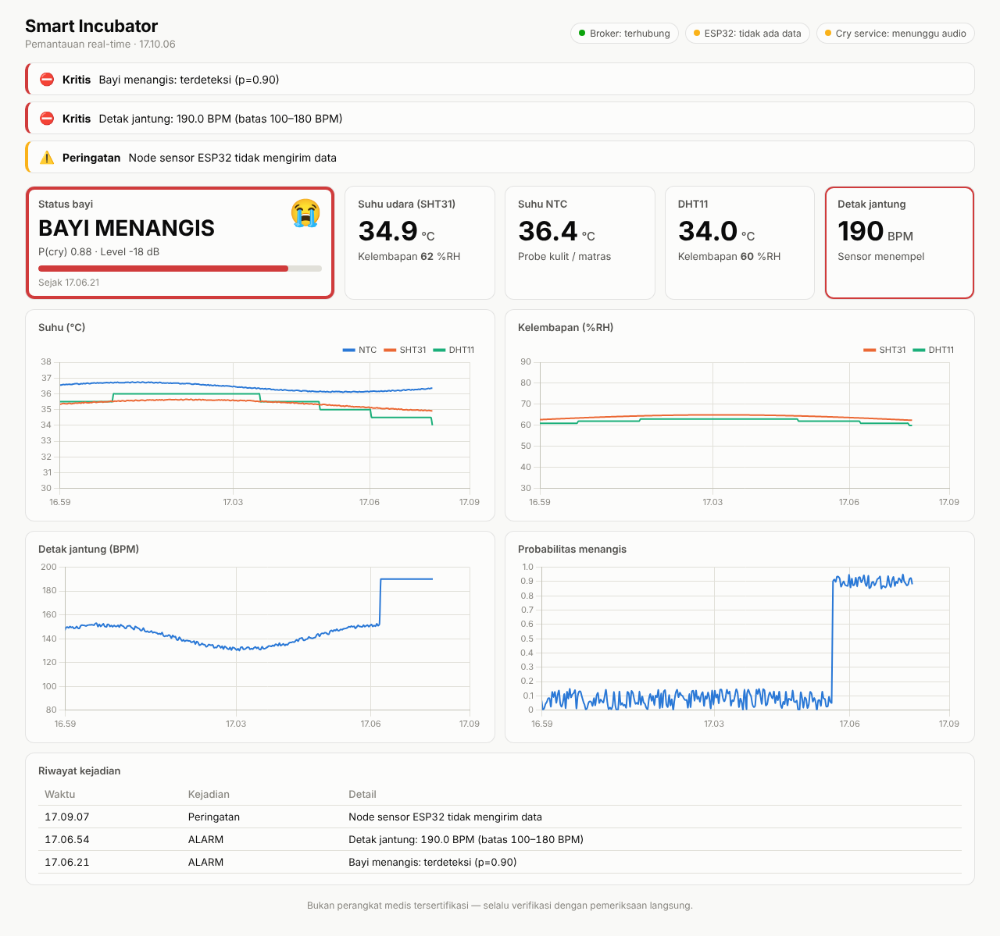

# Smart Incubator

Pemantauan inkubator bayi: suhu, kelembapan, detak jantung, dan deteksi tangisan,
ditampilkan real-time di web dashboard.

```
┌──────────────────────┐   MQTT 1883    ┌─────────────────── Raspberry Pi 5 ───────────────────┐
│ ESP32-S3             │ ─────────────▶ │ Mosquitto ◀── cry_service.py ◀── Mic Bluetooth (HFP) │
│  NTC (ADC)           │ incubator/     │    │            (TFLite)                             │
│  SHT31 (I2C0)        │  sensors       │    │ WebSockets 9001 (lokal)                         │
│  DHT11               │                │    ▼                                                 │
│  MAX30102 (I2C1)     │                │  nginx :80 ── /       → dashboard (HTML/JS)          │
└──────────────────────┘                │           └─ /mqtt   → proxy ke Mosquitto WS         │
                                        └──────────────────────────────────────────────────────┘
                                                         ▲ browser (HP / laptop di LAN)
```

## Isi proyek

| Folder | Isi |
|---|---|
| `esp32s3-firmware/` | Firmware PlatformIO (Arduino). Pengaturan di `include/config.h` |
| `raspberry-pi/mosquitto/` | Konfigurasi broker + ACL (setiap klien hanya boleh menulis ke topic miliknya) |
| `raspberry-pi/nginx/` | Webserver dashboard + proxy WebSocket `/mqtt` |
| `raspberry-pi/dashboard/` | Web dashboard (MQTT.js + Chart.js), batas alarm di `config.js` |
| `raspberry-pi/cry-recognition/` | Layanan klasifikasi tangisan (TFLite) |
| `raspberry-pi/scripts/` | `setup_pi.sh` (instalasi sekali jalan), `connect_bt_mic.sh` |
| `raspberry-pi/systemd/` | User service agar cry recognition otomatis jalan saat boot |

---

## 1. Wiring ESP32-S3 (DevKitC-1)

| Sensor | Pin sensor | ESP32-S3 |
|---|---|---|
| SHT31 | VIN / GND / SDA / SCL | 3V3 / GND / **GPIO8** / **GPIO9** |
| MAX30102 | VIN / GND / SDA / SCL | 3V3 / GND / **GPIO17** / **GPIO18** |
| DHT11 | VCC / DATA / GND | 3V3 / **GPIO4** (+ pull-up 10 kΩ ke 3V3 bila modul tanpa resistor) / GND |
| NTC 10k | divider | `3V3 ── 10 kΩ ──┬── NTC ── GND`, titik tengah ke **GPIO1** |
| HX711 + load cell | VCC / GND / DT / SCK | 3V3 / GND / **GPIO5** / **GPIO6** (load cell ke E+/E−/A+/A− modul HX711) |

- NTC wajib di pin ADC1 (GPIO1–10): ADC2 tidak bisa dipakai saat WiFi aktif.
- MAX30102 sengaja di bus I2C kedua supaya pembacaan detak jantung (100 Hz, di task FreeRTOS
  sendiri) tidak terganggu pembacaan SHT31/DHT11.
- Sesuaikan `NTC_BETA`, `NTC_R_NOMINAL`, `NTC_R_SERIES` dengan datasheet NTC Anda.
- Pakai **MAX30100**? Library SparkFun hanya untuk MAX30102/30105; ganti dengan
  `oxullo/MAX30100lib` dan sesuaikan `heartRateTask()`.

## 2. Setup Raspberry Pi 5

Raspberry Pi OS (Bookworm/Trixie, 64-bit). Salin folder proyek ke Pi, lalu:

```bash
cd smart-incubator/raspberry-pi
chmod +x scripts/*.sh
./scripts/setup_pi.sh
```

Script akan menanyakan password untuk 4 akun MQTT:

| User | Hak | Dipakai oleh |
|---|---|---|
| `esp32` | tulis `incubator/sensors`, `incubator/esp32/status` | firmware |
| `cryservice` | tulis `incubator/cry/#` | cry_service.py |
| `dashboard` | **baca saja** `incubator/#` | browser (password terlihat di JS, makanya read-only) |
| `admin` | semua | debugging |

Disarankan memberi Pi **IP statis** (atau reservasi DHCP di router), karena IP ini
dipakai di `config.h` ESP32.

## 3. Flash ESP32-S3

1. Edit `esp32s3-firmware/include/config.h`: WiFi, `MQTT_HOST` (IP Pi), `MQTT_PASS` (password user `esp32`).
2. Dengan VS Code + PlatformIO: *Upload*, atau CLI:
   ```bash
   cd esp32s3-firmware
   pio run -t upload && pio device monitor
   ```
3. Cek di Pi: `mosquitto_sub -h localhost -u admin -P '<pw>' -t 'incubator/#' -v`

## 4. Mic Bluetooth

Pairing sekali (lihat komentar di `scripts/connect_bt_mic.sh`), lalu isi MAC-nya
di `~/.config/smart-incubator/cry.env` (`BT_MIC_MAC=AA:BB:CC:DD:EE:FF`).
Script otomatis dijalankan sebelum service start: menyambung mic, memilih profil
**headset (HFP/HSP)**, dan menjadikannya input default.

> Penting: lewat Bluetooth, mic hanya aktif di profil HFP/HSP yang kualitasnya
> **16 kHz (mSBC)** atau bahkan **8 kHz (CVSD)**. Jika model dilatih pada audio
> 22–44 kHz, frekuensi di atas 8 kHz akan hilang dan akurasi bisa turun. Uji dengan
> rekaman dari mic yang sama; bila perlu, latih ulang/fine-tune model dengan audio
> yang di-resample ke 16 kHz. Jika memungkinkan, mic USB memberi kualitas lebih baik
> (cukup ganti `audio.device` di config).

Cek perangkat: `.venv/bin/python cry_service.py --list-devices`

## 5. Model cry recognition

1. Salin model ke `raspberry-pi/cry-recognition/model/cry_model.tflite`.
2. Pastikan urutan `labels.txt` sama dengan urutan output model (default: `cry`, `not_cry`).
   Jika output model hanya 1 neuron (sigmoid), nilainya dianggap P(`positive_label`).
3. Jalankan diagnosa:
   ```bash
   cd raspberry-pi/cry-recognition
   .venv/bin/python inspect_model.py --wav contoh_tangisan.wav
   ```
   Script menampilkan bentuk input model dan **preprocessing yang ditebak otomatis**
   (waveform / MFCC / rata-rata MFCC / mel-spectrogram, beserta panjang jendela audio).
4. **Cocokkan dengan kode training Anda** dan sesuaikan `features:` di `config.yaml`.
   Yang paling sering perlu dicek:

   | Di kode training | Di `config.yaml` |
   |---|---|
   | `librosa.load(path, sr=...)` (default 22050) | `sample_rate` |
   | `librosa.feature.mfcc(n_mfcc=...)` | `type: mfcc`, `n_mfcc` |
   | `np.mean(mfcc, axis=1)` | `type: mfcc_mean` |
   | `librosa.feature.melspectrogram(n_mels=...)` + `power_to_db` | `type: melspec`, `n_mels`, `power_to_db` |
   | `n_fft`, `hop_length` | `n_fft`, `hop_length` |
   | durasi potongan audio (mis. 3 detik) | `window_seconds` |
   | normalisasi `(x - mean) / std` | `normalize: standardize` |

   Jika normalisasi memakai mean/std **seluruh dataset** (bukan per-sampel), tambahkan
   konstanta itu di `CryModel.features()`.
5. Verifikasi dengan file dari dataset (hasilnya harus sesuai label aslinya):
   ```bash
   .venv/bin/python cry_service.py --test-file dataset/cry/001.wav
   .venv/bin/python cry_service.py --test-file dataset/not_cry/001.wav
   ```
6. Jalankan service:
   ```bash
   systemctl --user start cry-recognition
   journalctl --user -u cry-recognition -f
   ```

Pengaturan inferensi (`inference:`): inferensi tiap `hop_seconds`, audio di bawah
`silence_db` dilewati, status "menangis" baru aktif setelah `consecutive_for_alert`
jendela berturut-turut di atas `cry_threshold` (mengurangi alarm palsu).

Mendukung model float32 maupun kuantisasi int8/uint8. Jika model memakai op
TensorFlow tambahan (Flex/SELECT_TF_OPS), install `tensorflow` di venv sebagai ganti `ai-edge-litert`.

## 6. Dashboard

Buka `http://<ip-pi>/` dari perangkat di jaringan yang sama. Halaman pertama adalah
**login**: masukkan akun MQTT (biasanya `dashboard`, password yang dibuat saat
`setup_pi.sh`). Mosquitto yang memeriksa password, jadi password tidak lagi disimpan
di `config.js`. Centang "Keep me signed in" agar tidak perlu login ulang di perangkat itu.
Setelah memperbarui file dashboard, salin ulang ke Pi:
`sudo cp -r raspberry-pi/dashboard/. /var/www/smart-incubator/`. Batas alarm
(suhu, kelembapan, BPM) diatur di `/var/www/smart-incubator/config.js`
(sumbernya `raspberry-pi/dashboard/config.js`).



## Topic MQTT

| Topic | Arah | Isi |
|---|---|---|
| `incubator/sensors` | ESP32 → | `{"ntc":{"temp"},"sht31":{"temp","hum"},"dht11":{"temp","hum"},"heart":{"bpm","contact","ir","sensor_ok"},"weight":{"g","raw","calibrated","sensor_ok"},"uptime_s","rssi"}` tiap 2 detik; nilai gagal = `null` |
| `incubator/esp32/status` | ESP32 → | `online` / `offline` (retained, Last Will) |
| `incubator/cry/result` | Pi → | `{"label","confidence","cry_prob","probabilities","level_db","is_cry","latency_ms","ts"}` tiap jendela |
| `incubator/cry/state` | Pi → | `{"crying","since","cry_prob","ts"}` (retained, hanya saat berubah) |
| `incubator/cry/status` | Pi → | `online` / `no_mic` / `offline` (retained, Last Will) |
| `incubator/cmd/#` | → ESP32 | dicadangkan untuk kontrol (heater, kipas, dsb.) |

## Catatan keselamatan

Sistem ini alat bantu pemantauan, **bukan perangkat medis tersertifikasi**. Jangan
jadikan satu-satunya dasar keputusan klinis; kalibrasi sensor suhu terhadap
termometer referensi, dan tentukan batas alarm bersama tenaga medis.
